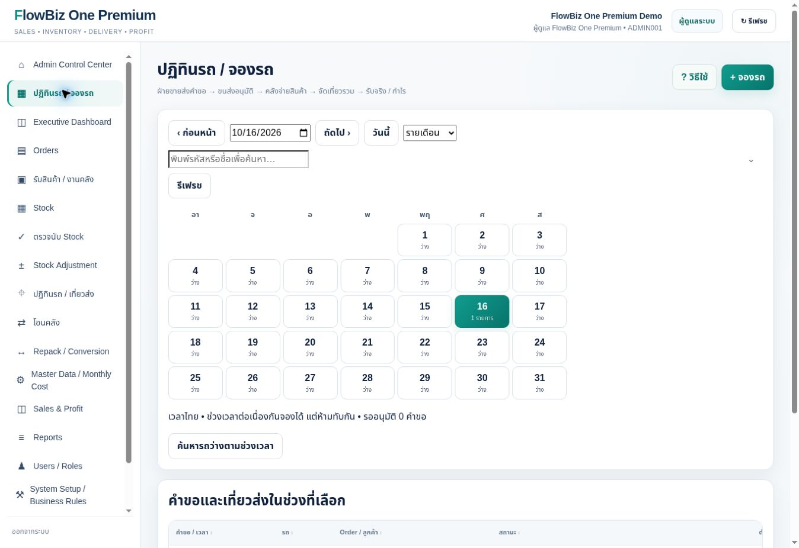
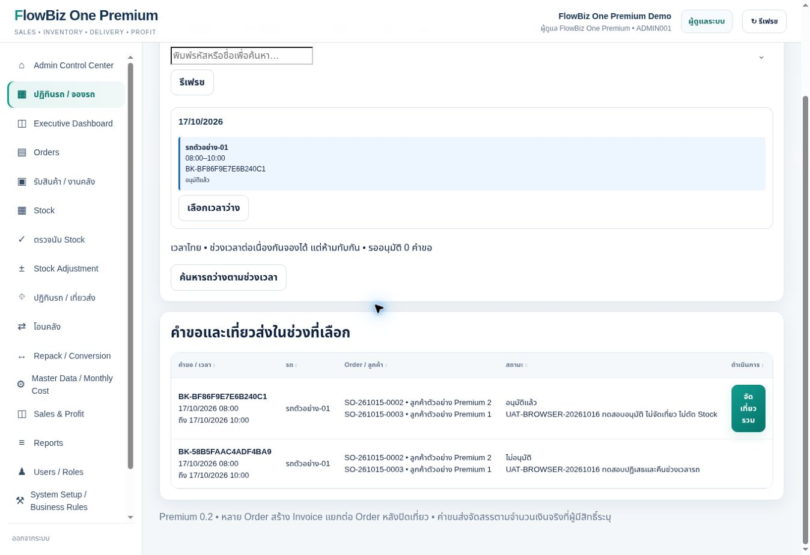

# ผลตรวจและแก้ปฏิทินรถด้วยเบราว์เซอร์จริง — 16/10/2026

## รุ่นที่เผยแพร่

เว็บไซต์ https://flowbiz-one-premium.tnlx-acc.chatgpt.site/
Sites รุ่น 8; runtime flowbiz-premium.js?v=20261016-4
Source Site commit 4456e933fe992694ae0277887e1c1ee9d85116f5
GitHub implementation commit 42ea7df6c3cce1f0e64c40809187dddf6e1bdc33; CI ผ่าน
ใช้ Repository เดิม ไม่มีการแก้ Standard ไม่มี Restore ไม่มีบริการเสียเงินเพิ่ม

## สาเหตุที่พบและแก้จริง

1. Build ใช้ String.replace แบบ replacement string ทำให้ $$ ใน Premium กลายเป็น $ แก้เป็น replacement callback เพื่อรักษาโค้ดทุกอักขระ
2. wirePage ไม่ได้เรียก premiumWire เมื่อเปิด bookings แก้ให้เรียกเมื่อเปิดหน้าปฏิทิน มิฉะนั้นเห็นหน้าแต่ปุ่มไม่ทำงาน
3. รายเดือนนับเฉพาะคำขอ ไม่รวมเที่ยวส่งเดิม และไม่ครอบคลุมช่วงข้ามวัน ปรับให้อ่าน occupancy เดียวกับรายวันและทดสอบกรณีข้ามเที่ยงคืน
4. เพิ่ม regression กับไฟล์ dist ที่ Build แล้ว เรียก wirePage จริง ไม่อ้างเพียง render ของไฟล์ต้นฉบับ

## ผลเบราว์เซอร์จริงด้วย Admin

Login ผ่าน browserAuth ด้วยบัญชี Admin Premium ที่ผู้ใช้กรอกโดยตรง ไม่รับหรือบันทึกรหัสผ่านในแชต

| กรณี | ผล |
|---|---|
| Admin เห็นเมนูและคลิกเปิดปฏิทิน | ผ่าน |
| DOM ระบุ script runtime เวอร์ชัน 20261016-4 | ผ่าน |
| เปลี่ยนรายวัน/รายสัปดาห์/รายเดือน | ผ่าน |
| คลิกวันที่ 17 แล้ววันที่หน้าจอเปลี่ยนเป็น 17/10/2026 | ผ่าน |
| เปิดแบบฟอร์มและเลือก 2 Order ต่างลูกค้า | ผ่าน |
| ส่งคำขอแล้วปุ่มถูกปิดขณะบันทึก และมีข้อความสำเร็จ | ผ่าน |
| ช่วง 08:00–10:00 ขณะมีคำขอขึ้นไม่ว่าง | ผ่าน |
| ช่วงต่อกัน 10:00–12:00 ขึ้นจองได้ | ผ่านการค้นหารถว่าง ไม่ใช่สร้างสองเที่ยวจริงในรอบ browser นี้ |
| ปฏิเสธพร้อมเหตุผล | ผ่าน |
| ส่งคำขอใหม่และยืนยันอนุมัติ | ผ่าน |
| รายเดือนแสดงเที่ยวส่งเดิมวันที่ 16 เป็น 1 รายการ หลังแก้ | ผ่าน |

คำขอทดสอบ BK-58B5FAAC4ADF4BA9 สถานะ REJECTED
คำขอทดสอบ BK-BF86F9E7E6B240C1 อนุมัติผ่าน UI แล้วเปลี่ยนเฉพาะรายการทดสอบเป็น CANCELLED ผ่าน SQL พร้อม Audit UAT_CLEANUP เพื่อคืนสิทธิ์รถและ Order ไม่จัดเที่ยว ไม่ลบข้อมูล และไม่ถือเป็นการทดสอบปุ่มยกเลิกหน้าเว็บ

## Stock / Invoice / Freight / Profit

ตรวจ fingerprint ทั้งฐาน Premium ก่อนและหลังคำขอ/อนุมัติ/ปฏิเสธ:

- stock_balances = 426d177e4aa0ddf543485f724f0cce80 เท่าเดิม
- invoices = 9f503c5ab8d1b1d5731a8eebcbcf11c0 เท่าเดิม (รวมยอดค่าขนส่งและต้นทุนในข้อมูล Invoice)
- stock_movements = 7 เท่าเดิม
- actual_expenses = 0 เท่าเดิม

ยืนยันว่าขั้นตอนจองและอนุมัติที่ทดสอบไม่เปลี่ยน Stock หรือข้อมูลที่ใช้คำนวณกำไร ไม่ได้ทดสอบปิดเที่ยว/สร้าง Invoice ผ่าน browser ในรอบนี้

## Console และข้อจำกัด

ก่อน Login ตรวจ Console พบเฉพาะ error จากส่วนขยาย Chrome ไม่พบ error ตัวแอปในผลช่วงนั้น
หลัง Login การอ่าน dev.logs ถูกระบบป้องกันข้อมูลรับรองของ browser ปฏิเสธ จึงไม่ประกาศว่า Console ไม่มี error หลัง Login ใช้การคลิกจริงและ regression ไฟล์ Build ยืนยันการแก้ handler แทน
ภาพหน้าจอเป็นภาพจริง ไม่ใช่ภาพจำลอง

## ยังไม่ผ่านการยืนยัน

- Login จริงด้วย SALES และ LOGISTICS แยกบัญชี และทำรายการร่วมกัน
- บริษัท FlowBiz One Premium Demo มี Admin เพียง 1 บัญชี ไม่มี Sales/Logistics ในบริษัทนี้ ส่วนบัญชี Role เหล่านั้นที่พบอยู่บริษัท UAT แยก ใช้อีเมล example.invalid จึงใช้ email reset จริงไม่ได้
- ไม่เปลี่ยน Role บัญชี Admin เพื่อแสร้งว่า Login ผ่าน Sales/Logistics
- การสร้างหลายเที่ยวจริง, ปิดเที่ยว, POD upload, รับไม่ครบ/คืนสินค้า และพร้อมกันหลายคน ยังไม่ใช่ผลผ่าน browser รอบนี้

**ไม่รับรอง UAT 100% ทั้งระบบ**

## ภาพหลักฐาน

